# Rick and Morty — app

Aplicativo mobile em React Native com Expo para explorar personagens e episódios
de Rick and Morty. É possível pesquisar e filtrar personagens, abrir detalhes,
consultar episódios, alternar o tema e salvar favoritos localmente para acessar
mesmo sem internet.

## Pré-requisitos

- Node.js LTS e npm
- Android Studio com um emulador Android configurado (para Android)
- Xcode e CocoaPods (para iOS, somente macOS)

## Como rodar

A partir da raiz do repositório:

```bash
cd rickandmorty-rn
npm install
npm start
```

No terminal do Expo, escolha uma plataforma. Também é possível executar
diretamente:

```bash
npm run android # emulador Android aberto
npm run ios     # macOS + simulador iOS
npm run web
```

`npm run android` faz a primeira compilação nativa e pode levar alguns minutos.
O app usa a Rick and Morty API, portanto a lista, a busca, os filtros e os
detalhes precisam de internet. Favoritos já salvos continuam disponíveis offline.

## Testes e validação

```bash
npm run typecheck
npm test -- --runInBand
npx expo prebuild --platform android
```

O `typecheck` valida o TypeScript. O teste unitário da store cobre adição,
remoção e ausência de duplicatas. O `prebuild` verifica que o projeto nativo
Android pode ser gerado; ele não substitui a compilação em um emulador.

## Funcionalidades

- Lista paginada de personagens com pull-to-refresh.
- Busca por nome (com debounce) e filtro por status.
- Estados de carregando, vazio, erro com "Tentar de novo" e aviso de sem internet.
- Tela de detalhe com informações, episódios relacionados e compartilhamento.
- Aba de episódios com navegação para os personagens.
- Favoritos persistidos em AsyncStorage, com snapshot de nome, foto e status,
  contador na aba e remoção com desfazer.
- Tema claro/escuro e componentes visuais compartilhados.

## Arquitetura

```text
src/
  api/          HTTP e DTOs da API
  domain/       tipos e funções puras
  queries/      estado do servidor com TanStack Query
  stores/       estado local com Zustand (favoritos e tema)
  theme/        tokens e temas do React Native Paper
  components/   componentes reutilizáveis
  screens/      UI; as telas não fazem fetch diretamente
  navigation/   abas e stack dos detalhes
```

O estado vindo da API fica no TanStack Query; escolhas do usuário, como
favoritos e tema, ficam no Zustand. A decisão arquitetural completa, incluindo
alternativas consideradas, está em [`ADR.md`](ADR.md).

## Screenshots

Capturas do APK de release no emulador Android (API 35). Os arquivos ficam em
[`docs/screenshots/`](../docs/screenshots/).

### Por funcionalidade

| Funcionalidade | Responsável | Captura |
|---|---|---|
| **F1 · Lista** de personagens com scroll infinito | Paulo | 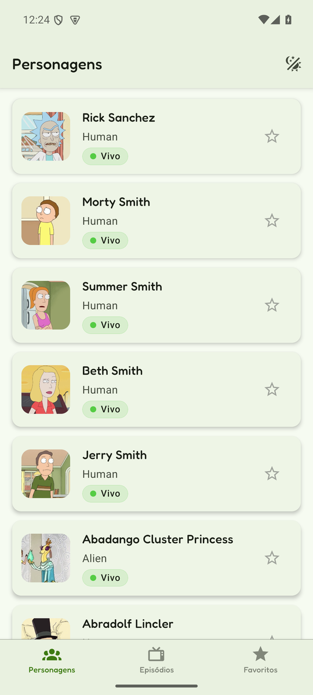 |
| **F2 · Detalhe** do personagem | Vinícius | 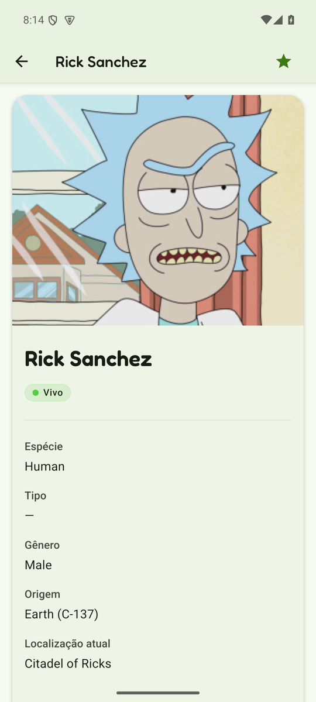 |
| **F3 · Busca** por nome + estados vazio, erro e sem internet | Hugo | 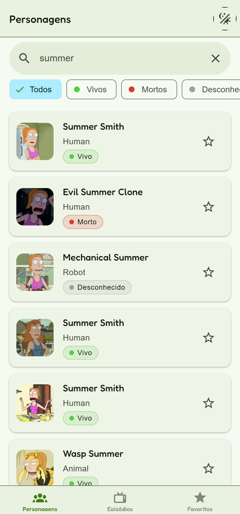 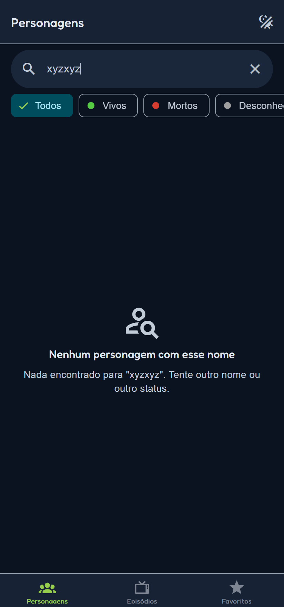 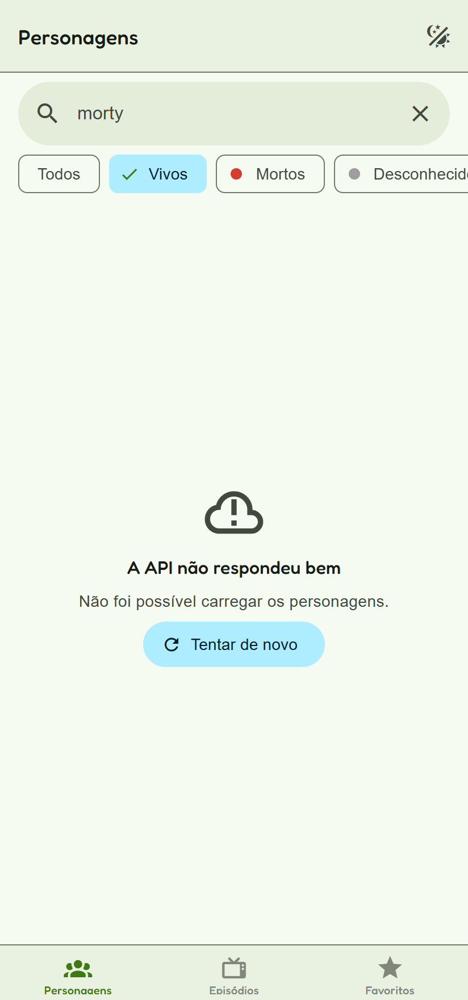 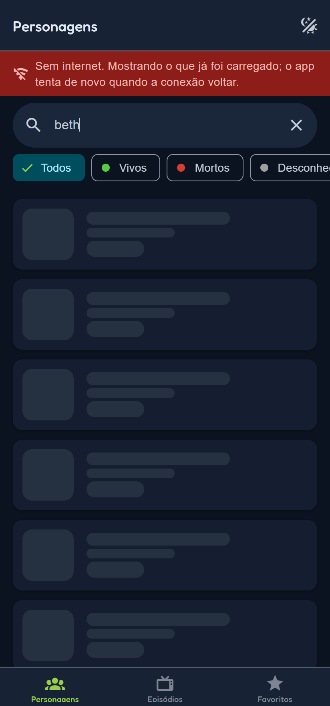 |
| **F4 · Filtro** por status, na API | Guilherme | 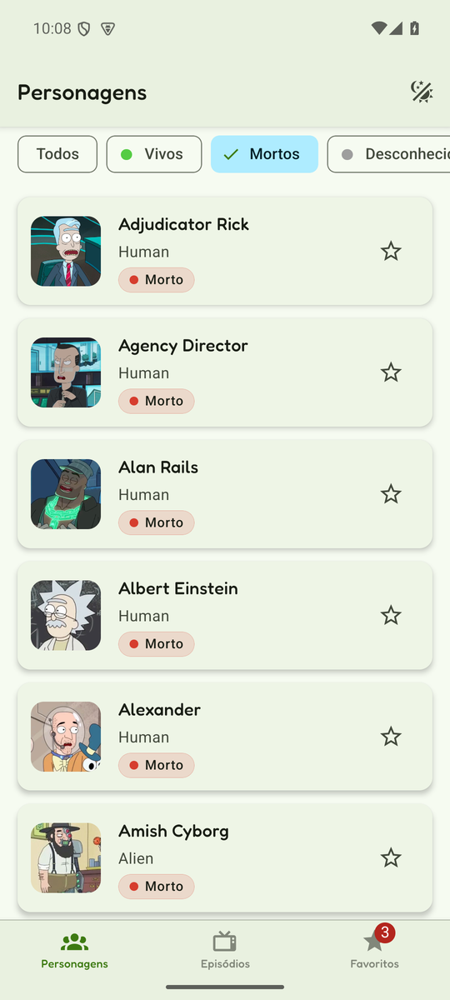 |
| **F5 · Favoritos** com desfazer, salvos no aparelho | Marcus | 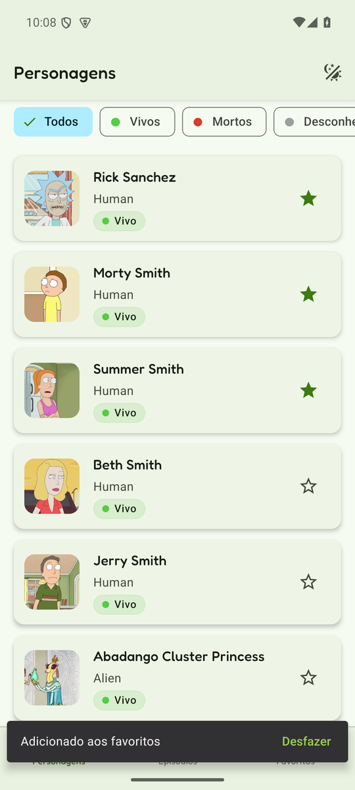 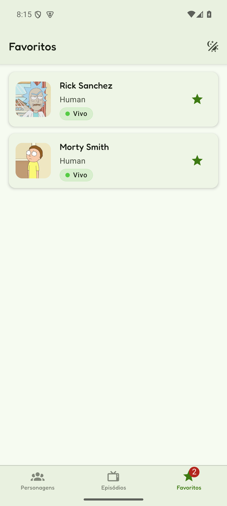 |
| **F6 · Episódios** por temporada, detalhe e "Aparece em N episódios" | Rafael | 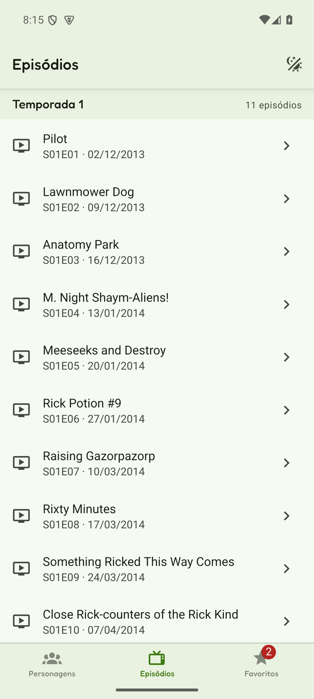 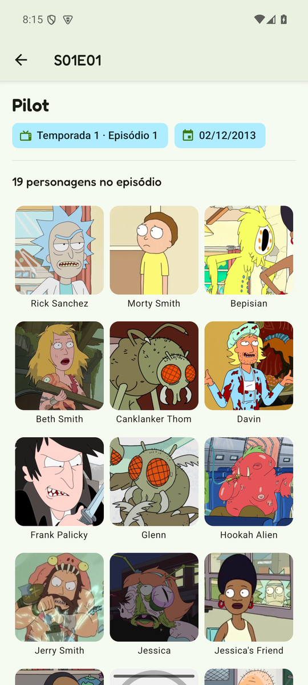 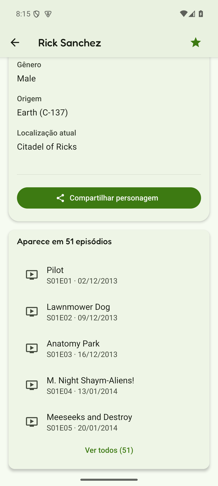 |
| **F7 · Tema** Sistema, Claro e Escuro + design system | Sesaque | 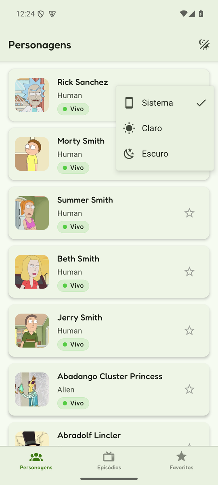 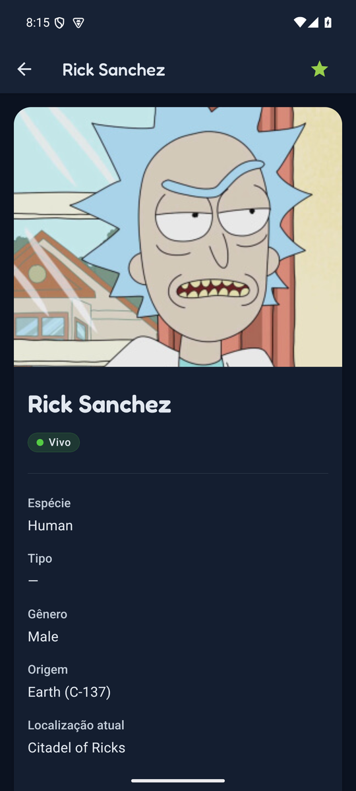 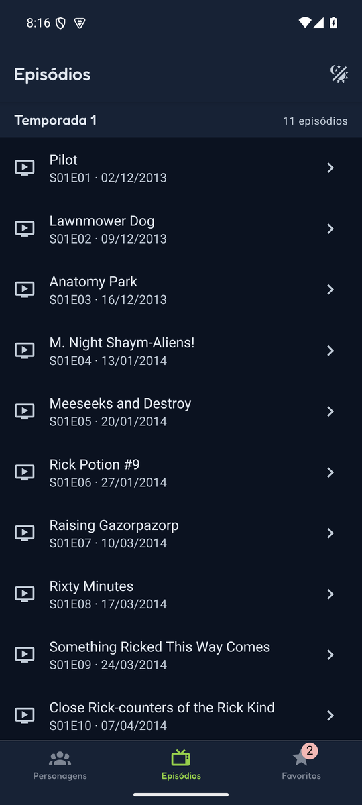 |

### F7 · Tema claro e escuro em todas as telas

| | Claro | Escuro |
|---|---|---|
| **Personagens** (lista, filtro e favoritos) |  | 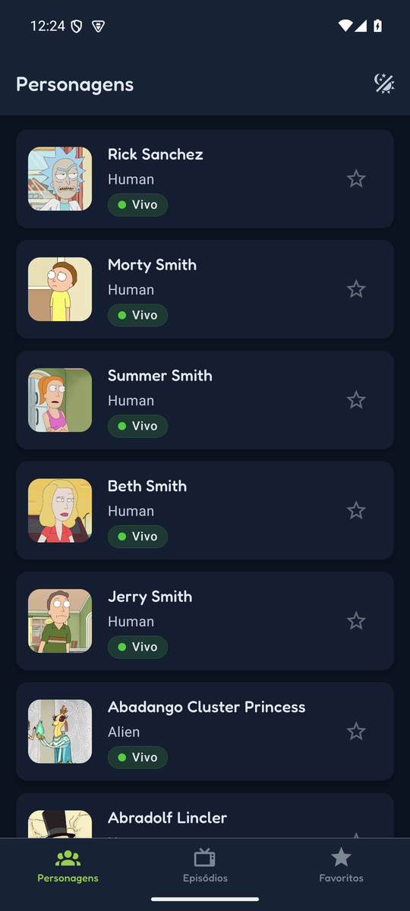 |
| **Detalhe** do personagem |  |  |
| **Episódios** por temporada |  |  |
| **Favoritos** salvos |  | 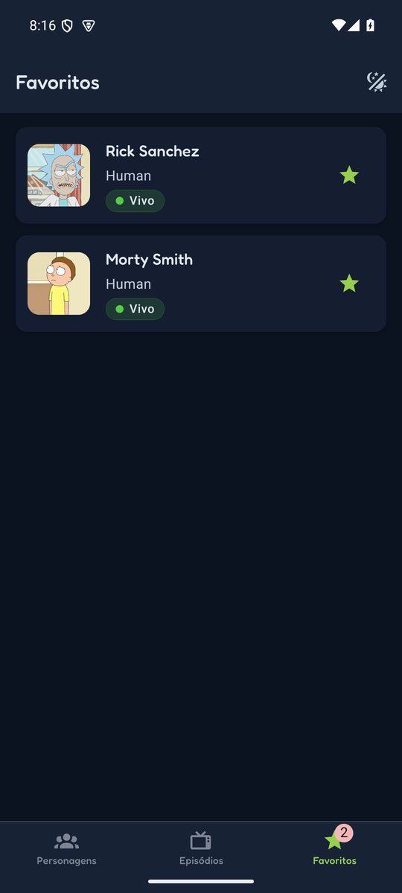 |

## Estrutura de pastas

O app mantém a separação `screens → queries/stores → api → domain`. Isso permite
que cada feature evolua sem duplicar fetch, cache ou regras de mapeamento e
mantém os testes independentes da rede.
